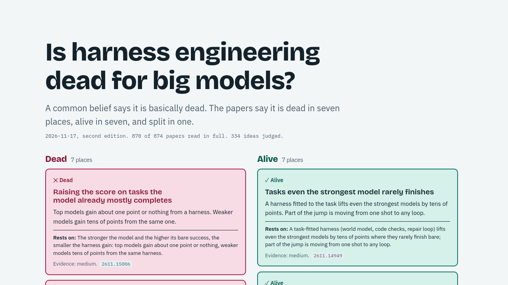

# Is harness engineering dead for big models?

A study of 874 papers on what a harness (the program around a language model: prompts, tools, memory, checks, retries) still decides when the model is a strong one. One animated page, plus the data behind it.

**Read the page: https://gsalucci.github.io/harness-engineering-2026/**

<a href="https://gsalucci.github.io/harness-engineering-2026/"></a>

## The answer in short

The papers say the harness is dead in seven places, alive in seven, and split in one. "Dead" means dead on a strong model.

Dead:

- Raising the score on tasks the model already mostly completes.
- Choosing among mature general harnesses.
- Roles, delegation and parallel runs, at equal budget.
- The model checking its own work.
- Adding a memory system.
- Automatic harness evolution where the bare model mostly succeeds.
- General skill libraries.

Alive:

- Tasks even the strongest model rarely finishes.
- Knowledge the model does not have.
- Weaker and mid-strength models.
- Cost.
- Checking from outside the model.
- Safety and permissions.
- Measuring.

Split: reasoning effort.

## What is in the repository

- `index.html`: the page, one file.
- [`data/`](data/): five tab-separated tables, one header row each. [`data/README.md`](data/README.md) describes every column.
  - `papers.tsv`: 874 papers.
  - `claims.tsv`: 4,267 claims, each with a word-for-word quote.
  - `designs.tsv`: 4,378 designs, each with a word-for-word quote.
  - `patterns.tsv`: 539 design patterns.
  - `ideas.tsv`: 334 ideas, each with a verdict.
- `assets/`: images.

## How it was made, and its limits

874 papers (837 from arXiv, 37 from other sources) were published between 5 March and 15 November 2026 and fetched between 1 March and 17 November 2026. 870 were read in full. They yielded 4,267 claims and 4,378 designs, each with a word-for-word quote, and 539 design patterns. 334 ideas were judged one topic at a time: 269 survived, 42 are contested, 14 stale, 6 unmeasured and 3 superseded.

Language models did the reading, the extraction and the judging. A script checked that each quote exists in its paper and found about 97 percent. A quote found in its paper shows the sentence exists, not that it supports the claim. No person re-read the tables. Authors mostly score their own systems. Three "dead" verdicts have contested neighbouring ideas. This is the author's collection of papers, not a complete census. The last section of the page lists every limit; read it before quoting a number.

The page is one file, `index.html`. It loads the GSAP animation library from cdnjs and its fonts from Google Fonts, and nothing else.

## Use the data

The files are tab-separated, so `cut` reads them. Skip the header with `tail -n +2`. Column numbers come from [`data/README.md`](data/README.md).

How many ideas got each verdict (`status`, column 11 of `ideas.tsv`):

```
$ tail -n +2 data/ideas.tsv | cut -f11 | sort | uniq -c | sort -rn
    269 survived
     42 contested
     14 stale
      6 unmeasured
      3 superseded
```

How the papers say the harness gain moves as models get stronger (`trend`, column 11 of `papers.tsv`):

```
$ tail -n +2 data/papers.tsv | cut -f11 | sort | uniq -c | sort -rn
    825 unstated
     25 mixed
     12 shrinks
      7 grows
      5 holds
```

Claims about frontier models, by direction (`tier` is column 9 and `direction` is column 5 of `claims.tsv`):

```
$ tail -n +2 data/claims.tsv | awk -F'\t' '$9=="frontier"{print $5}' | sort | uniq -c | sort -rn
    739 harness-helps
    440 not-applicable
    145 harness-hurts
     99 harness-no-effect
```

## Found a mistake?

Open an issue and pick a form: [a paper contradicts a verdict](../../issues/new?template=contradicting_paper.yml), or [something in the data or the page is wrong](../../issues/new?template=data_error.yml). See [`CONTRIBUTING.md`](CONTRIBUTING.md) for how reports are handled.

## Cite

Giancarmine Salucci (2026). Is harness engineering dead for big models? https://gsalucci.github.io/harness-engineering-2026/

Machine-readable form: [`CITATION.cff`](CITATION.cff).

## Licence

Text and data: [Creative Commons Attribution 4.0 International](https://creativecommons.org/licenses/by/4.0/). Quoted sentences belong to the authors of the papers they come from. Full licence text: [`LICENSE`](LICENSE); credit line and notes: [`NOTICE.md`](NOTICE.md).
